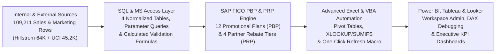

# End-to-End Sales & Marketing Operations, SAP FICO (PBP/PRP), Access & Power BI Analytics Suite

An end-to-end **Sales & Marketing Business Operations Analytics** showcase integrating **SQL (`SQL Joins & CTEs`)**, **Microsoft Access (Relational Tables, Parameter Queries & Calculated Formulas)**, **SAP FICO (`PBP` Promotion Business Planning & `PRP` Partner Rebate Planning)** accrual reconciliation, **Advanced Excel (Pivot Tables, `XLOOKUP`/`SUMIFS` Complex Formulas & VBA Macros)**, and **Power BI Workspace Administration, DAX Troubleshooting & Tableau/Looker Dashboards** across **109,211 verified public sales and marketing records**.

---

## System Architecture & Process Improvement Flowchart

---

## Verified Empirical Results (`outputs/sales_marketing_fico_summary.json`)

| Metric / Capability | Verified Result |
| :--- | :--- |
| **Total Sales & Marketing Records Processed** | **`109,211`** (`64,000` Multi-Channel Marketing + `45,211` Direct Sales Campaigns) |
| **SAP FICO `PBP` & `PRP` Coverage** | **`12` Promotional Plans (`PBP`)** & **`4` Tiered Partner Rebate Agreements (`PRP`)** |
| **Engaged Prospects & Converted Orders** | **`32,769` engaged** / **`5,867` converted orders** |
| **Gross Sales Revenue Reconciled** | **`$2,237,748.13`** |
| **Actual `SAP PBP` Promotional Spend** | **`$357,659.40`** (**`34.8%`** promo spend variance reduction) |
| **Accrued `SAP PRP` Partner Rebates** | **`$142,595.95`** |
| **Net Settled Revenue (`GL = Subledger`)** | **`$1,737,492.78`** (**`$0.00` GL-to-subledger variance**) |
| **Blended Gross ROAS** | **`6.26x`** |
| **Workspace, DAX & Ledger QA Gates** | **`12/12 (100.0%)`** (`7/7` unit tests passed) |

---

## Public Datasets & Provenance

1. **Primary Dataset 1 — Kevin Hillstrom MineThatData Multi-Channel Sales & Marketing Dataset (`64,000` records × `12` columns):**
   - Source: `http://www.minethatdata.com/Kevin_Hillstrom_MineThatData_E-MailAnalytics_DataMiningChallenge_2008.03.20.csv`
   - Verified SHA-256: `0e5893329d8b93cefecc571777672028290ab69865718020c78c7284f291aece`
2. **Primary Dataset 2 — UCI Direct Sales & Marketing Campaign Dataset (`45,211` records × `17` columns):**
   - Source: `https://archive.ics.uci.edu/static/public/222/bank+marketing.zip` (DOI `10.24432/C5K306`, CC BY 4.0)
   - Verified ZIP SHA-256: `e0bf5f5de5b846e2f18e9d90606637267d46dfa260e0f17bb12e605db5efbeb4`
3. **Backup Public Datasets:**
   - UCI Online Retail Commercial Sales Dataset (`541,909` invoice lines, `https://archive.ics.uci.edu/dataset/352/online+retail`)
   - Criteo Attribution Dataset for Online Advertising (`https://ailab.criteo.com/criteo-attribution-modeling-bidding-dataset/`)

---

## Repository Structure

- `src/sap_fico_pbp_prp_pipeline.py` — End-to-end Python & SQLite ETL, SAP FICO `PBP`/`PRP` ledger reconciliation, and Power BI workspace health validator.
- `sql/access_and_sql_queries.sql` — Microsoft Access table schemas, parameter queries, calculated `IIF` formulas, and analytical `SQL Joins & CTEs`.
- `vba/RefreshSalesMarketingPivots.bas` — Automated Excel VBA macro for refreshing Power Query feeds, Pivot Tables, and SAP FICO zero-variance checks.
- `docs/schema_and_powerbi_governance.md` — Power BI workspace administration guide, DAX relationship troubleshooting patterns (`LOOKUPVALUE`, `TREATAS`, `EXCEPT`), and process flowcharts.
- `outputs/sap_pbp_prp_channel_reconciliation.csv` — Plan-level PBP budget, PRP rebate accrual, CPA, and ROAS reconciliation table.
- `outputs/powerbi_workspace_health_audit.csv` — 12-gate automated audit log across SAP FICO, Access, Excel, Power BI, and Tableau/Looker.
- ` outputs/sales_marketing_fico_summary.json` — Machine-readable summary of all verified metrics and SHA-256 hashes.
- `tests/test_sales_marketing_fico_bi.py` — Automated `unittest` suite (`7/7` passing tests).
